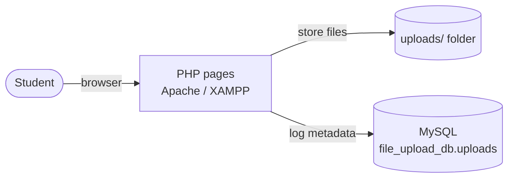

# ENotes: High-Level Design

An online notes-sharing platform for students: upload PDF or image notes, browse them, download and delete. Built with PHP and MySQL. For code-level detail see the [Low-Level Design](lld.md).

## 1. Context

## 2. Components

| Page | Responsibility |
|---|---|
| `index.php` | Upload form, list of files in `uploads/`, status message |
| `upload.php` | Validates and saves the file, records it in MySQL |
| `download.php` | Streams a file as an attachment |
| `delete.php` | Deletes a file from `uploads/` |
| `database.txt` | SQL to create the database and table |

## 3. Rules

| Rule | Value |
|---|---|
| Allowed types | JPG, PNG, PDF |
| Max size | 2 MB |
| File names | Reduced to their base name (no folder paths) |

## 4. Tech

| Item | Choice |
|---|---|
| Server | PHP (no framework) on Apache, e.g. XAMPP |
| Database | MySQL via `mysqli` prepared statements |
| UI | HTML and CSS inside `index.php` |
