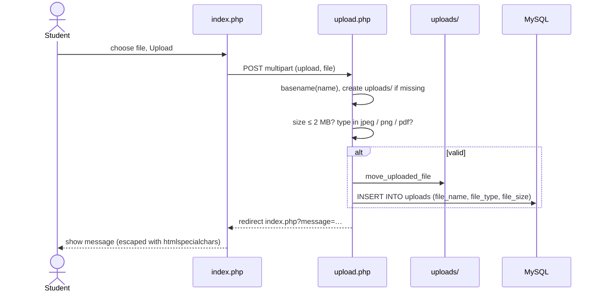

# ENotes: Low-Level Design

For the big picture see the [High-Level Design](hld.md).

## 1. Database

```sql
CREATE TABLE uploads (
  id INT AUTO_INCREMENT PRIMARY KEY,
  file_name VARCHAR(255) NOT NULL,
  file_type VARCHAR(50) NOT NULL,
  file_size INT NOT NULL,
  upload_date TIMESTAMP DEFAULT CURRENT_TIMESTAMP
);
```

The table is a log of uploads; the list on the home page is read from the `uploads/` folder with `glob("uploads/*")`.

## 2. Upload sequence



## 3. Download and delete

| Page | Input | Behavior |
|---|---|---|
| `download.php` | `GET file` | `basename()`, check it exists, send `Content-Disposition: attachment` headers, `readfile()` |
| `delete.php` | `POST file_name` | `basename()`, `unlink()` if it exists, redirect with a message |

## 4. Security notes

| Topic | Current state | Improvement |
|---|---|---|
| Path traversal | Prevented with `basename()` | — |
| SQL injection | Prevented with prepared statements | — |
| File type | Uses the browser-reported MIME type | Check the real type with `finfo` |
| Access control | Anyone can delete any file | Add login and ownership |
| Same-name uploads | Overwrite the existing file | Add a unique prefix |
